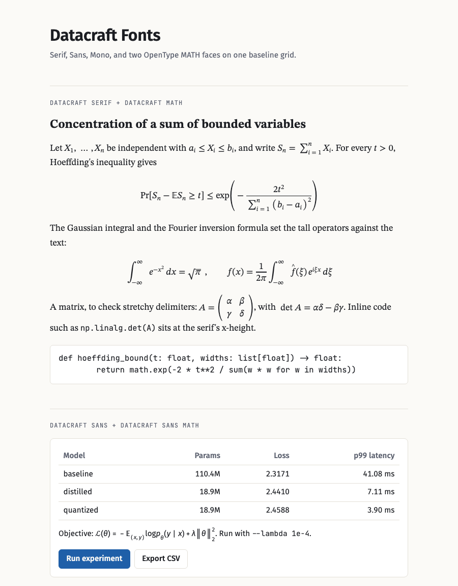

# Datacraft fonts

Five font families for equation-heavy writing: papers, technical blog posts and web app UIs. Text, math and code share one set of vertical metrics, so a formula or a code span in the middle of a sentence keeps the baseline and the line spacing steady.



| Family | For | Built from | Styles |
|---|---|---|---|
| **Datacraft Serif** | Papers, long-form posts | STIX Two Text | 400 to 700, italic |
| **Datacraft Math** | Equations with Serif | STIX Two Math | OpenType MATH |
| **Datacraft Sans** | UI, headings, slides | Fira Sans | 300 to 700, italic |
| **Datacraft Sans Math** | Equations with Sans | Fira Math | OpenType MATH |
| **Datacraft Mono** | Code, data, terminals | JetBrains Mono | 100 to 800, italic |

Each math face matches its text face, so an italic *x* in an equation is the same letter as the *x* in the sentence around it.

## Quick start

**Web.** Copy `css/` and `fonts/web/` to your site, then:

```html
<link rel="stylesheet" href="/css/datacraft.css">
<article class="dc-prose">...</article>   <!-- Serif text, Datacraft Math, scaled code -->
<div class="dc-ui">...</div>              <!-- Sans text, Sans Math, tabular figures -->
```

Equations need to be MathML: render LaTeX with [Temml](https://temml.org), or with KaTeX's `output: "mathml"`.

**LaTeX** (LuaLaTeX or XeLaTeX), after installing the fonts and `latex/datacraft.sty`:

```latex
\usepackage{datacraft}          % papers
\usepackage[sans]{datacraft}    % slides
```

**Desktop.** Download the desktop archive from [releases](https://github.com/nyimbi/datacraft_fonts/releases) and install the files listed in [the install guide](docs/install.md#which-files-to-install).

## Documentation

| Guide | Covers |
|---|---|
| [Installing](docs/install.md) | macOS, Windows, Linux, LaTeX, websites, uninstalling |
| [Web](docs/web.md) | CSS classes and variables, MathML with Temml and KaTeX, Tailwind, Next.js, performance |
| [LaTeX and Pandoc](docs/latex.md) | the `datacraft` package, unicode-math, Pandoc to PDF and HTML |
| [Typst, Word, matplotlib, editors](docs/other-tools.md) | setup for each tool, with its limits |
| [Design rationale](docs/design.md) | why these fonts, the shared metrics, figure styles |
| [Reference](docs/reference.md) | every face, its metrics, names and OpenType features |
| [Building and contributing](docs/building.md) | the build, the tests, updating upstream fonts, releases |

Open `specimen/index.html` in a browser to see every face.

## What Datacraft is

Datacraft is a coordinated build of five open-source fonts, not a newly drawn typeface. The build renames each font, gives all five the same vertical metrics, cuts static instances of the variable fonts for LaTeX and office apps, and generates the web files, stylesheet and LaTeX package. Glyph outlines, kerning, features and math tables are unchanged. [Design rationale](docs/design.md) explains each choice.

## Known limits

- Fira Math, the source of Datacraft Sans Math, is a pre-1.0 release with fewer symbols than Datacraft Math. If a symbol is missing in a sans document, switch it to Serif and Datacraft Math.
- Datacraft Math is 545 KiB as WOFF2. Don't subset it, since that breaks stretchy brackets. Load it only on pages with equations.
- MathJax and KaTeX's default HTML output draw equations with their own fonts and won't use Datacraft Math.
- Datacraft Serif comes in weights 400 to 700 only.

## License

SIL Open Font License 1.1, inherited from STIX Two (© The STIX Fonts Project Authors), Fira Sans (© The Mozilla Foundation and Telefonica S.A.), Fira Math (© Xiangdong Zeng) and JetBrains Mono (© The JetBrains Mono Project Authors). You can use, embed, bundle and modify the fonts, but not sell them on their own. Every font ships with its license; provenance is in [sources/INDEX.md](sources/INDEX.md).
